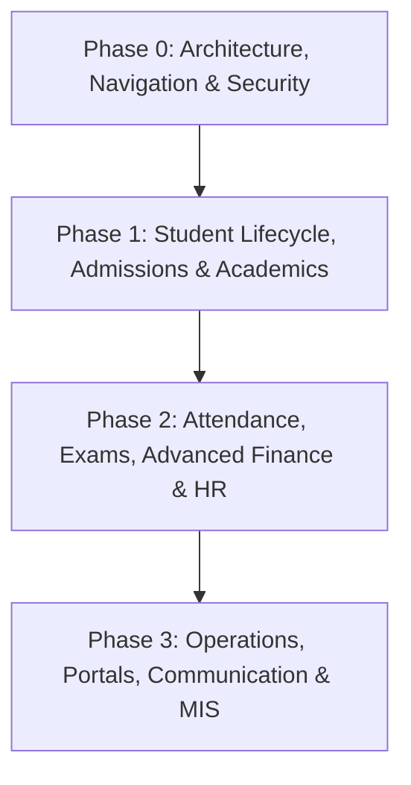

# School ERP Implementation Roadmap

**Project:** Shiksha Mitra — Single-School ERP Software (CBSE & State Board)  
**Audit Reference:** `prototype/module-audit/MODULE_AUDIT_REPORT.md`  
**Target Architecture:** Laravel 11 + MySQL 8 + Bootstrap 5.3  

---

## Roadmap Overview

Based on the forensic audit of the existing codebase, the core engine currently covers basic **User Management**, **Setup Tables**, **Student Bio Data & Enrollment**, **Staff Records & Basic Attendance**, **Marks Entry & Grade Rules**, **Basic Fee Collection**, and **Profit/Marksheet Reports**.

To achieve a production-grade, comprehensive School ERP covering all 55 modules, development must proceed in prioritized phases:

---

## Phase 0: Immediate Fixes & Foundation (Sprint 1)
> **Goal:** Eliminate all navigation defects, polish responsive UI, and secure foundational data structures.

* **Task 0.1:** Connect header notification bell to an interactive alerts modal with mock/live event notifications.
* **Task 0.2:** Replace all placeholder hash links (`href="#"`) with proper route helpers or accessible button elements.
* **Task 0.3:** Add dynamic hierarchical breadcrumbs on all inner views (`@section('breadcrumb')`).
* **Task 0.4:** Fix horizontal scrolling overflow on data tables on mobile viewports (<768px).
* **Task 0.5:** Build School Master Profile configuration page (Module 2) so school name, logo, affiliation code, and address dynamically populate on all PDF marksheets, ID cards, and receipts.

---

## Phase 1: Admissions, SIS, & Core Academics (Sprint 2 - 4)
> **Goal:** Complete the student onboarding pipeline, daily student attendance, and classroom scheduling.

### 1.1 Daily Student Attendance (Module 17 - P0)
* Create `student_attendances` migration (student_id, class_id, year_id, date, attend_status).
* Build teacher quick attendance interface (`/students/attendance/view`, `/students/attendance/add`).
* Add 1-click "Mark All Present", absent alerts, and monthly attendance matrix view.

### 1.2 Admission CRM & Intake Pipeline (Modules 6 & 7 - P1)
* Build Enquiry registration form with pipeline status tracking (New $\rightarrow$ Contacted $\rightarrow$ Visited $\rightarrow$ Form Sold $\rightarrow$ Admitted).
* Create Admission Application review queue with document checklist.
* Add 1-click "Promote to Enrolled Student" button syncing with `users` and `assign_students`.

### 1.3 Extended Student Profile & Lifecycle (Modules 8, 9 & 10 - P1)
* Expand student profile into tabbed view:
  * Personal & Parent Details
  * Medical Records & Emergency Contacts
  * Document Locker (Birth Certificate, Aadhar, Previous Marksheet)
* Build School Leaving Certificate (SLC / TC) and Character Certificate auto-generation with fee-clearance validation.

### 1.4 Timetable & Class Schedule (Module 13 - P1)
* Create `timetables` migration (class_id, day, period, subject_id, teacher_id, room_no).
* Build interactive visual grid scheduler (Monday–Saturday, 8 periods).
* Add conflict detector for duplicate teacher or classroom allocation.
* Create proxy/substitute teacher assignment for absent staff.

---

## Phase 2: Advanced Finance, Examinations & Operations (Sprint 5 - 8)
> **Goal:** Modernize billing, automate statutory payroll, exam datesheets, and fleet transport.

### 2.1 Advanced Fee Management (Modules 25, 26 & 28 - P1)
* Add late fine rule engine (grace days + daily or fixed penalty).
* Implement multi-installment billing breakdown (Term 1, Term 2, Term 3).
* Create dual-copy printable fee receipt voucher (Student Copy & School Office Copy).
* Build Fee Defaulters recovery register with 1-click reminder triggers.

### 2.2 Examination Datesheet & Admit Cards (Module 20 - P1)
* Create exam datesheet generator by Class and Exam Type.
* Build printable Admit Card / Hall Ticket with student photo, exam roll, timetable, and instructions.

### 2.3 Comprehensive Staff Payroll (Module 32 - P2)
* Add earnings (Basic, DA, HRA, Allowances) and statutory deductions (PF, ESI, TDS, PT).
* Generate formal monthly salary slips with breakdown.
* Export bank NEFT/RTGS salary disbursement sheet.

### 2.4 Transport Fleet Management (Module 34 - P1)
* Vehicle Master (Bus No, RC, Fitness, Insurance, Pollution expiry alerts).
* Driver & conductor directory with license verification.
* Route & stop manager with pickup timings and monthly transport fee allocation.

### 2.5 Library Circulation System (Module 35 - P1)
* Book cataloguing register (ISBN, Accession No, Title, Author, Shelf location).
* Issue & Return counter with barcode scanner input support.
* Automatic overdue fine calculator and book reservation ledger.

---

## Phase 3: Portals, Communication & Compliance (Sprint 9 - 12)
> **Goal:** Empower parents, teachers, and students through dedicated self-service portals and government reporting.

### 3.1 Role-Specific Portals (Modules 39, 40 & 41 - P1)
* **Parent Portal:** Student report card, fee dues payment, daily attendance calendar, teacher messages.
* **Student Portal:** Homework assignments, class schedule, digital library, online quiz.
* **Teacher Portal:** Today's timetable, quick attendance marker, marks entry, student diary, leave application.

### 3.2 Communication & Notification Center (Module 42 - P1)
* Broadcast SMS & WhatsApp notification composer.
* Class circulars, event announcements, and emergency school alerts.
* Delivery status logbook.

### 3.3 Inventory & Procurement (Module 36 - P2)
* Stationery, sports, and laboratory consumables inventory.
* Purchase order workflow and stock inward/outward ledger.

### 3.4 Government & Compliance Reporting (Module 53 - P2)
* Automated UDISE+ compliant student data export (CSV/Excel).
* CBSE OASIS mandatory disclosure and board returns.
* RTE 25% quota monitoring register.

### 3.5 Executive MIS Analytics Dashboard (Module 55 - P1)
* High-level operational intelligence:
  * Annual Financial Revenue vs Expenditure trends.
  * Class-wise Academic Pass & Distinction distribution.
  * Real-time Student & Staff attendance rates.
  * Comprehensive custom export center.

---

## Summary Deliverables & Checkpoints

| Phase | Duration | Core Deliverables | Verification Milestone |
|---|---|---|---|
| **Phase 0** | 1 Week | Polish UI, fix broken links, dynamic breadcrumbs, school profile | Zero dead links, 100% mobile responsive |
| **Phase 1** | 3 Weeks | Daily Student Attendance, Admission CRM, SIS Locker, Timetable | Full admission-to-classroom workflow functional |
| **Phase 2** | 4 Weeks | Late fines, Printable Receipts, Admit Cards, Payroll, Bus, Library | Financial integrity & operational management active |
| **Phase 3** | 4 Weeks | Parent/Student/Teacher Portals, SMS Broadcasts, UDISE+, MIS | Multi-role self-service & executive analytics live |
